# SplitPay – Dossier technique de conception (Validation 1)

**Module AWD – ESPRIT – Année universitaire 2026-2027**
**Projet :** SplitPay – partager les dépenses, se rembourser en un clic et épargner sans y penser (thème **FinTech**)
**Équipe :** 6 membres (voir §10) – **Stack :** Angular · Spring Boot · PostgreSQL (+ MongoDB, Redis) · RabbitMQ · Docker

---

## 1. Description du sujet

### 1.1 Contexte et problématique
Les étudiants en colocation ou en sortie de groupe avancent régulièrement de l'argent les uns pour les autres (courses, loyer, internet). Les remboursements sont suivis « à la main » : relances, oublis, retards et tensions. Les dépenses récurrentes sont recalculées chaque mois, et les petits budgets laissent peu de place à l'épargne.

**Problématique :** *comment automatiser le partage, le suivi et le remboursement des dépenses d'un groupe d'étudiants, de façon fiable et sécurisée (un montant ne doit jamais être débité deux fois ni se perdre), tout en les aidant à épargner ?*

### 1.2 Solution proposée
**SplitPay** permet de :
- créer une **colocation / un groupe** et y inviter des membres ;
- enregistrer une **dépense partagée** (qui a payé, part de chacun) ;
- générer automatiquement les **dettes** et notifier les débiteurs ;
- **rembourser en un clic** via un **portefeuille intégré** ;
- programmer des **dépenses récurrentes** (loyer, internet, abonnements) ;
- **épargner par arrondi** (chaque paiement est arrondi à l'euro supérieur, la différence va dans l'épargne) ;
- **détecter en temps réel les transactions suspectes** et geler un portefeuille en cas de risque élevé.

Le choix des microservices est justifié par des besoins très différents : un portefeuille exige de la **cohérence transactionnelle**, les dépenses sont des **documents** (parts imbriquées, donc MongoDB), la planification est une **tâche de fond**, et la détection de fraude est un **traitement d'événements en temps réel**.

### 1.3 Améliorations apportées à l'idée initiale
| # | Constat sur l'idée de départ | Amélioration retenue |
|---|---|---|
| 1 | Aucun service ne gère les **groupes / colocations**, alors que les dépenses sont « partagées à 3 » | Les groupes et leurs membres sont gérés par **account-service** (contexte « identité et groupes ») |
| 2 | Le rôle **Administrateur** (KYC, transactions suspectes) n'a aucun microservice pour la surveillance | Nouveau **fraud-service** (technologie avancée) |
| 3 | Le JWT est émis par Account-Service, mais l'architecture imposée comprend **Keycloak** | **Keycloak** émet les JWT ; account-service garde le profil, le KYC et les groupes |
| 4 | L'arrondi (étape 6 : un *café* à 3,40 €) ne correspond à aucun événement : une dette de 20 € n'a pas de centimes | Wallet gère aussi des **paiements** (type `PURCHASE`) ; **savings-service consomme `wallet.debited`** au lieu de `debt.settled` |
| 5 | Risque de **double débit** si un appel est rejoué | **Clé d'idempotence** sur les transferts + déduplication des événements (`eventId`) |
| 6 | Montants à virgule | `BigDecimal` / `NUMERIC(19,2)`, jamais de `double` |
| 7 | Incohérence possible entre une écriture en base et la publication d'un événement | Patron **Outbox transactionnel** (recommandé) ou publication après `commit` + reprise |

### 1.4 Périmètre réaliste (MVP)
| Inclus | Hors périmètre |
|---|---|
| Inscription, connexion Keycloak, profil, KYC simplifié (document déclaré, validation par admin) | Vérification d'identité automatisée (OCR, biométrie) |
| Groupes, dépenses partagées (parts égales, pourcentages, montants exacts) | Multi-devises avec taux de change |
| Portefeuille : recharge simulée, transferts, paiement | Vrai traitement de cartes (Stripe en mode *sandbox* uniquement) |
| Dettes et remboursement en un clic | Simplification de dettes en chaîne (« A doit à B qui doit à C ») |
| Dépenses récurrentes mensuelles / hebdomadaires | Calendriers complexes |
| Épargne par arrondi + objectifs | Placements financiers |
| Détection de fraude à base de règles pondérées + alertes en direct | Apprentissage automatique |
| Notifications in-app + e-mail (SMTP de dev) | SMS, notifications push |

---

## 2. Acteurs et fonctionnalités

| Acteur | Rôle | Fonctionnalités |
|---|---|---|
| **Étudiant** | Utilisateur final | S'inscrire, soumettre son KYC, gérer ses groupes, alimenter son portefeuille, créer des dépenses, consulter et rembourser ses dettes, programmer des récurrences, épargner, lire ses notifications |
| **Administrateur** | Contrôle et conformité | Valider ou rejeter un KYC, surveiller les alertes de fraude en direct, configurer les règles de détection, confirmer ou rejeter une alerte |
| **Système de paiement externe (simulé)** | Acteur externe | Confirmer les recharges du portefeuille (mock ou Stripe sandbox) |
| **Système** | Acteur technique | Créer les dettes, déclencher les échéances, calculer les arrondis, scorer les transactions |

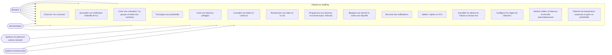

### Exemple de scénario (Alice, Bob et Chloé)
| Étape | Ce qui se passe | Services |
|---|---|---|
| 1 | Alice ajoute « Courses, 60 € » partagé à 3 : 20 € chacun | expense |
| 2 | 2 dettes sont créées (Bob → Alice 20 €, Chloé → Alice 20 €) | settlement |
| 3 | Bob et Chloé sont notifiés | notification |
| 4 | Bob clique « Payer » : 20 € passent de son portefeuille à celui d'Alice | settlement + wallet |
| 5 | La part de Bob devient « payée », Alice est prévenue | expense + notification |
| 6 | Bob paie un café de 3,40 € : 4 € prélevés, 0,60 € épargnés | wallet + savings |
| 7 | Le 1er du mois, le loyer de 600 € est créé et réparti | recurring + expense |
| 8 | Si Bob enchaîne 8 paiements en 3 minutes, son portefeuille est gelé et un admin est alerté | fraud + wallet |

> **Solde insuffisant :** le paiement est refusé (`409 INSUFFICIENT_FUNDS`), rien n'est débité, la dette reste `UNPAID`, l'utilisateur est prévenu.

---

## 3. Découpage en microservices

Le découpage suit les **contextes bornés** : une capacité métier par service, ses propres données, son propre cycle de vie.

| N° | Microservice | Contexte borné / responsabilités | Port | Base | Responsable |
|---|---|---|---|---|---|
| MS1 | **account-service** | Utilisateurs (profil), vérification d'identité KYC, **groupes** et membres | 8081 | PostgreSQL `account_db` | Membre 1 |
| MS2 | **wallet-service** | Portefeuille : solde, recharge, transferts, paiements, gel | 8082 | PostgreSQL `wallet_db` | Membre 2 |
| MS3 | **expense-service** | Dépenses partagées : payeur, parts de chacun, statut des parts | 8083 | **MongoDB** `expense_db` | Membre 3 |
| MS4 | **settlement-service** | Dettes entre utilisateurs et leur remboursement (orchestre le paiement) | 8084 | PostgreSQL `settlement_db` | Membre 4 |
| MS5 | **recurring-service** | Modèles de dépenses récurrentes et exécutions planifiées | 8085 | PostgreSQL `recurring_db` | Membre 5 |
| MS6 | **savings-service** | Arrondi, compte d'épargne, objectifs | 8086 | PostgreSQL `savings_db` | Membre 6 |
| MS7 | **fraud-service** *(technologie avancée)* | Règles de détection, scoring en temps réel, alertes, flux SSE | 8087 | PostgreSQL `fraud_db` + Redis (compteurs temporaires) | Membres 5 et 6 (pilote : Membre 5) |
| MS8 | **notification-service** *(commun)* | Notifications in-app et e-mail issues des événements | 8088 | PostgreSQL `notification_db` | Équipe (présenté par Membre 3) |

**Infrastructure :** API Gateway (8080), Eureka Server (8761), Config Server (8888), Keycloak (8180), RabbitMQ (5672 / 15672), Redis (6379).

### Justification
- **Un CRUD par membre :** chacun possède un service avec ses entités, ses endpoints `POST / GET / PUT / DELETE` et sa base (détail §7).
- **Wallet ≠ Settlement :** le portefeuille gère *l'argent* (solde, transferts atomiques) ; settlement gère *l'obligation de payer* (la dette et son cycle de vie). Une dette peut être annulée sans toucher au solde.
- **Expense en MongoDB :** une dépense est un document naturel contenant ses parts imbriquées (nombre variable de membres), lue et écrite d'un seul bloc, sans jointure.
- **Wallet en PostgreSQL :** transactions ACID et verrouillage optimiste (`version`) indispensables pour l'argent.
- **Fraud séparé :** charge asynchrone intensive, cycle de vie et technologie différents (Redis, SSE) ; il ne doit jamais ralentir un paiement (il observe les événements, il ne bloque pas l'appel).
- **Notification commun :** transverse, sans donnée métier d'un autre service.

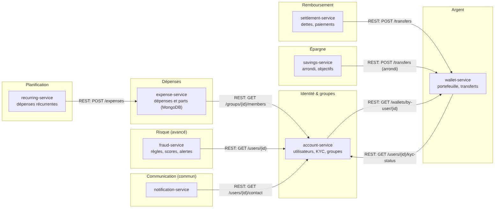

### Service avancé : fraud-service
| Aspect | Choix |
|---|---|
| Traitement | Consommation en continu des événements `wallet.debited`, `wallet.credited`, `debt.settled` |
| Technologies avancées | **Redis** (fenêtres glissantes via *sorted sets* + TTL), **Server-Sent Events** (alertes en direct vers l'interface admin), **idempotence** des consommateurs |
| Règles (pondérées, activables) | `VELOCITY` : plus de N débits en 5 min · `AMOUNT_ANOMALY` : montant > 3 × la moyenne de l'utilisateur · `NEW_ACCOUNT_HIGH_VALUE` : compte récent + gros montant · `PING_PONG` : A→B puis B→A rapidement · `FAILURE_BURST` : série d'échecs |
| Score | Somme des poids des règles déclenchées, plafonnée à 100 ; **≥ 70 = sévérité HIGH** |
| Action | HIGH → alerte `OPEN` + SSE + événement `fraud.alert-raised` → **wallet-service gèle le portefeuille** et notification envoyée |
| Pourquoi pas de blocage synchrone | Un paiement légitime ne doit pas attendre l'analyse ; le risque résiduel (quelques secondes) est assumé et documenté |

---

## 4. Données gérées par chaque service

Règles : **une base par service**, aucune base partagée ; références entre services = **identifiants seulement** (pas de clé étrangère inter-bases) ; montants en `NUMERIC(19,2)` / `Decimal128`.

| Service | Base | Justification | Entités |
|---|---|---|---|
| account-service | PostgreSQL | Données relationnelles (utilisateur ↔ groupes ↔ membres), contraintes d'unicité (e-mail) | `User`, `KycRequest`, `Group`, `GroupMember` |
| wallet-service | PostgreSQL | ACID, verrou optimiste, unicité de l'`idempotencyKey` | `Wallet`, `WalletTransaction`, `PaymentMethod` |
| expense-service | **MongoDB** | Document dépense avec parts imbriquées ; schéma souple (EQUAL / PERCENT / EXACT) | `Expense` + `Share` imbriqué |
| settlement-service | PostgreSQL | Intégrité des dettes, historique des tentatives de paiement | `Debt`, `Payment` |
| recurring-service | PostgreSQL | Requêtes sur `nextDueDate`, historique d'exécutions | `RecurringExpense`, `RecurringExecution` |
| savings-service | PostgreSQL | Soldes et objectifs ; unicité de `sourceEventId` (idempotence) | `SavingsAccount`, `SavingsGoal`, `RoundUp` |
| fraud-service | PostgreSQL + Redis | Règles / alertes durables ; compteurs temporaires à faible latence | `FraudRule`, `RiskProfile`, `FraudAlert`, `ProcessedEvent` |
| notification-service | PostgreSQL | Historique et statut de livraison | `Notification`, `DeliveryLog` |

### Diagrammes de classes
| Service | Diagramme |
|---|---|
| account-service | 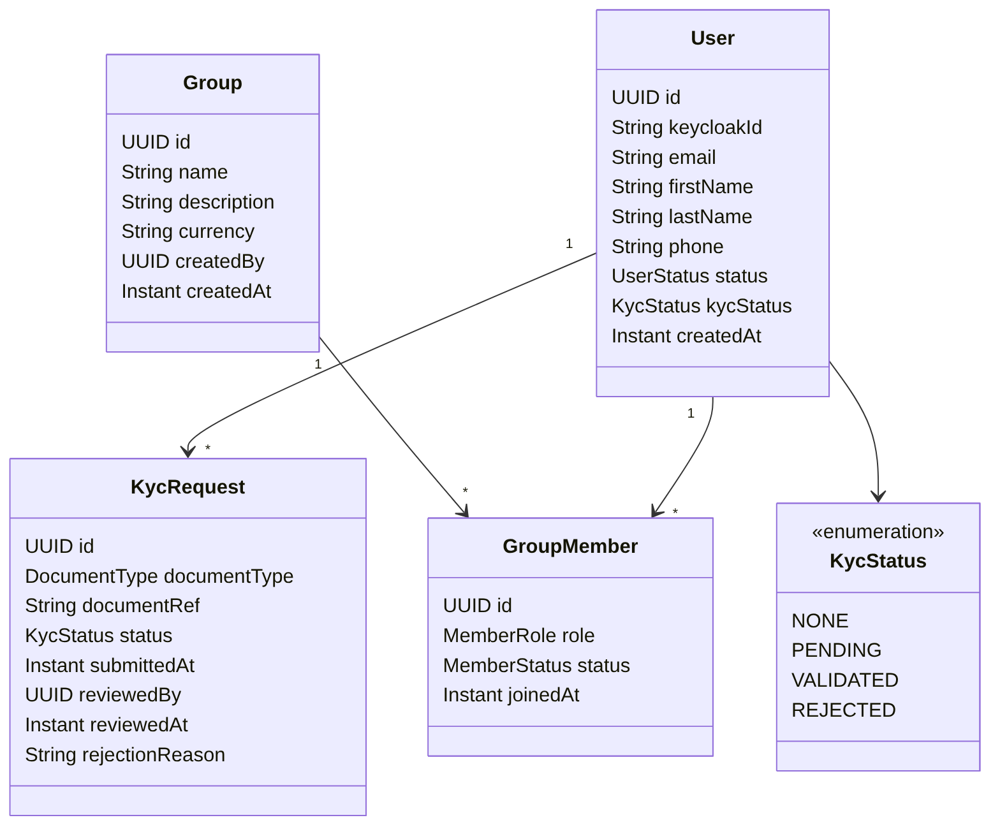 |
| wallet-service | 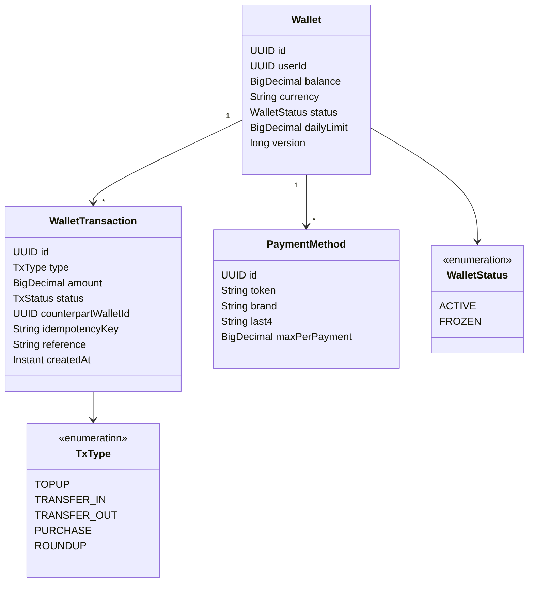 |
| expense-service | 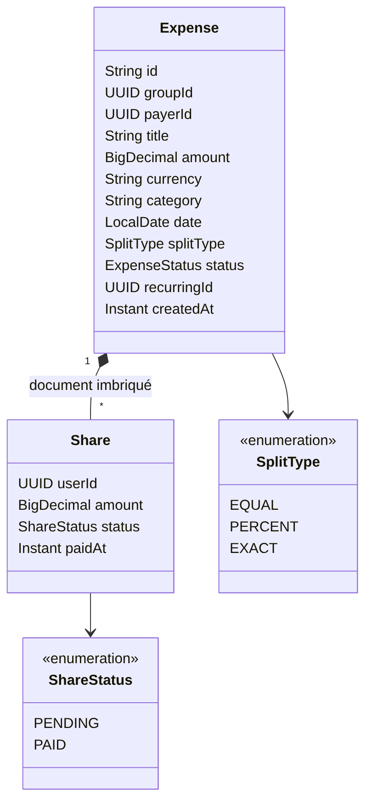 |
| settlement-service | 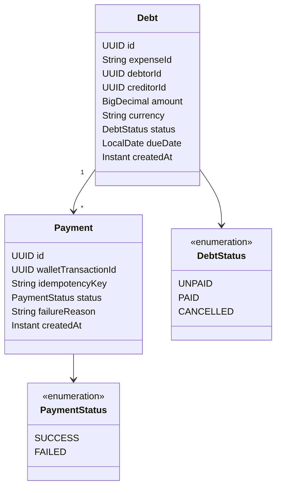 |
| recurring-service | 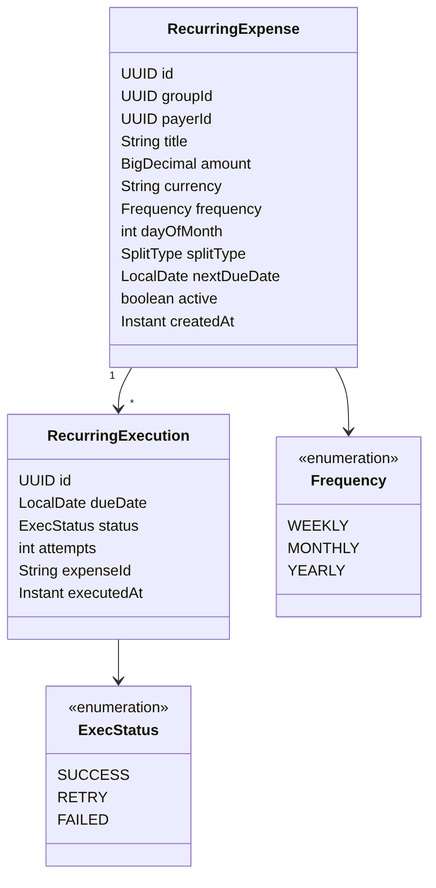 |
| savings-service | 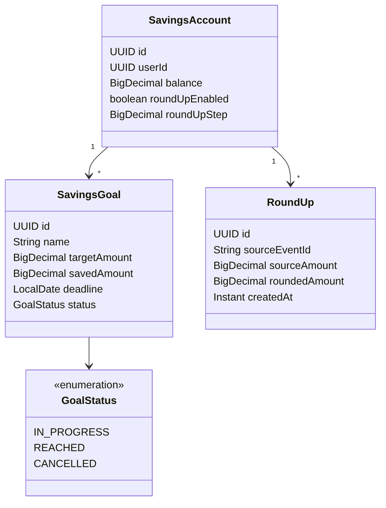 |
| fraud-service | 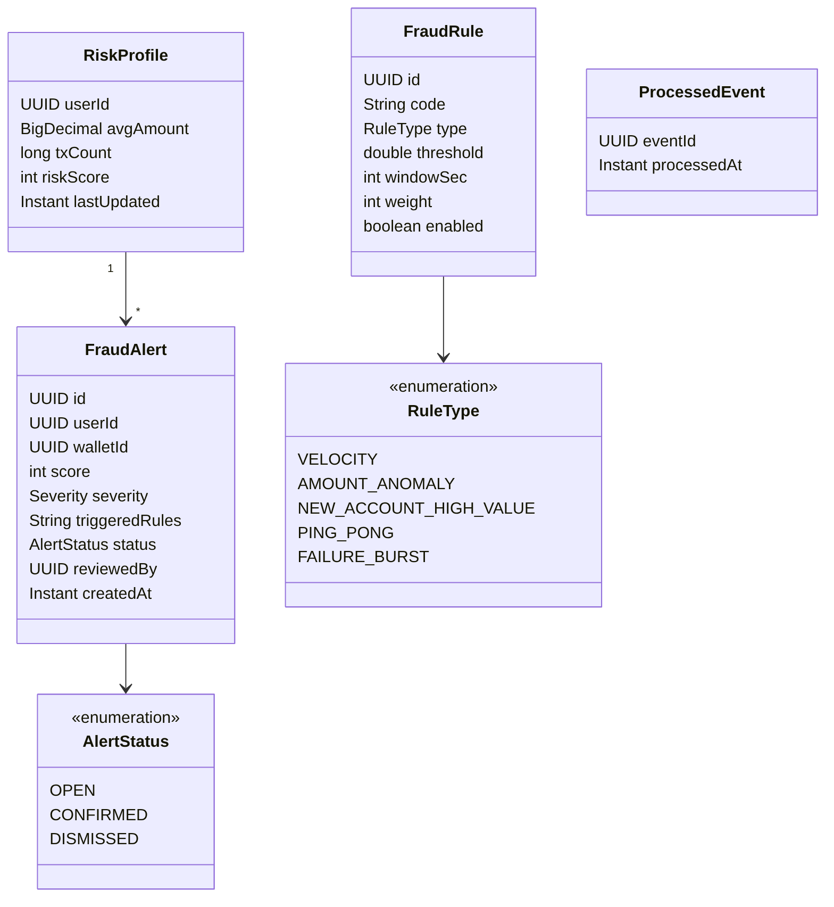 |
| notification-service | 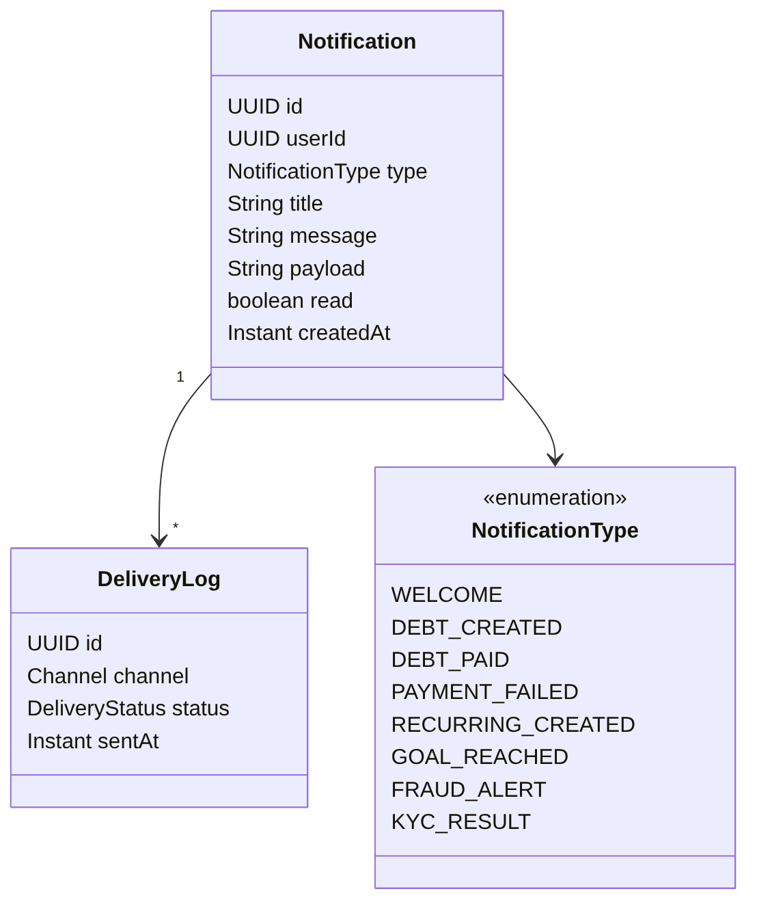 |

---

## 5. Interactions entre les services

### 5.1 Choix du mode de communication
- **Synchrone (REST / OpenFeign)** — comme un appel téléphonique : on a besoin de la réponse *maintenant* pour continuer (le portefeuille a-t-il assez d'argent ? les membres du groupe existent-ils ?).
- **Asynchrone (RabbitMQ)** — comme une annonce au micro : un service annonce un fait, ceux que cela intéresse réagissent, sans attendre. Cela découple les services (une panne de notification ne bloque jamais un remboursement).

### 5.2 Appels synchrones (OpenFeign)
| Appelant | Appelé | Endpoint | Données | Justification | Si l'appelé est indisponible |
|---|---|---|---|---|---|
| account | wallet | `GET /api/wallets/by-user/{userId}` | solde, statut | Afficher le profil avec son solde | Fallback : solde `null`, le profil s'affiche quand même |
| wallet | account | `GET /api/users/{id}/kyc-status` | statut KYC | Autoriser recharge / plafonds selon le KYC | Plafond minimal par défaut (mode dégradé) |
| expense | account | `GET /api/groups/{id}/members` | membres actifs | Valider les participants avant de répartir | `503`, aucune dépense enregistrée |
| settlement | wallet | `POST /api/wallets/transfers` (`Idempotency-Key`) | montant, wallets | Le remboursement exige la confirmation du débit | `503`, dette inchangée ; nouvel essai sans risque de double débit |
| recurring | expense | `POST /api/expenses` | dépense du mois | Créer la dépense réelle | Retry ×3 avec *backoff*, puis `recurring.failed` |
| savings | wallet | `POST /api/wallets/transfers` (type `ROUNDUP`) | 0,60 € | Déplacer l'arrondi vers l'épargne | L'arrondi est reporté (réessayé plus tard) |
| fraud | account | `GET /api/users/{id}` | ancienneté, KYC | Enrichir le score | Score calculé sans ce critère |
| notification | account | `GET /api/users/{id}/contact` | e-mail, préférences | Choisir le canal | Canal in-app uniquement |

Tous les appels Feign utilisent **Resilience4j** (timeout, retry limité, circuit breaker, *fallback*) et propagent le JWT.

### 5.3 Événements asynchrones (RabbitMQ)
**Exchange :** `splitpay.events` (*topic*). Une file durable par service (`<service>.queue`), avec file de rebut (*dead-letter*). **Enveloppe commune :**
```json
{
  "eventId": "uuid",
  "type": "debt.settled",
  "occurredAt": "2026-11-09T10:15:30Z",
  "producer": "settlement-service",
  "data": { }
}
```
Les consommateurs sont **idempotents** : un `eventId` déjà traité est ignoré.

| Routing key | Producteur | Payload | Consommateurs et effet |
|---|---|---|---|
| `user.registered` | account | userId, email | wallet (crée le portefeuille), notification (bienvenue) |
| `kyc.validated` / `kyc.rejected` | account | userId | wallet (relève / garde les plafonds), notification |
| `group.member-added` | account | groupId, userId | notification (invitation) |
| `wallet.created` | wallet | walletId, userId | account (mémorise l'état) |
| `wallet.debited` | wallet | walletId, userId, amount, type | savings (arrondi si `PURCHASE`), fraud |
| `wallet.credited` | wallet | walletId, userId, amount, type | fraud |
| `expense.created` | expense | expenseId, groupId, payerId, shares[], recurringId | settlement (crée les dettes), recurring (prochaine échéance) |
| `expense.cancelled` | expense | expenseId | settlement (annule les dettes `UNPAID`) |
| `debt.created` | settlement | debtId, debtorId, creditorId, amount | notification |
| `debt.settled` | settlement | debtId, expenseId, debtorId, creditorId, amount | expense (part → `PAID`), fraud, notification |
| `settlement.failed` | settlement | debtId, debtorId, reason | notification |
| `recurring.triggered` | recurring | recurringId, expenseId | notification |
| `recurring.failed` | recurring | recurringId, reason | notification |
| `roundup.saved` | savings | userId, amount | – |
| `goal.reached` | savings | userId, goalId | notification |
| `fraud.alert-raised` | fraud | alertId, userId, walletId, score | wallet (gel), notification |

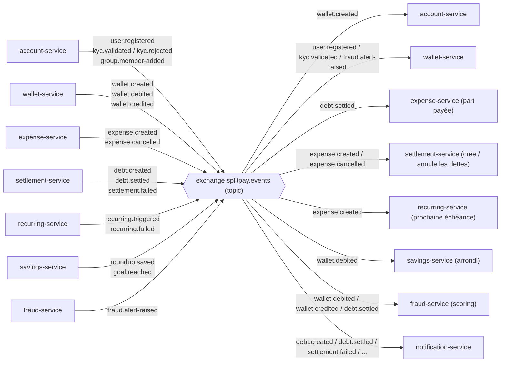

### 5.4 Exigence du cours : par étudiant
| Membre / service | ≥ 1 appel REST sync | ≥ 1 événement publié | ≥ 1 événement consommé |
|---|---|---|---|
| M1 account | → wallet (`by-user`) | `user.registered`, `kyc.validated`, `group.member-added` | `wallet.created` |
| M2 wallet | → account (`kyc-status`) | `wallet.created`, `wallet.debited`, `wallet.credited` | `user.registered`, `kyc.validated`, `fraud.alert-raised` |
| M3 expense | → account (`members`) | `expense.created`, `expense.cancelled` | `debt.settled` |
| M4 settlement | → wallet (`transfers`) | `debt.created`, `debt.settled`, `settlement.failed` | `expense.created`, `expense.cancelled` |
| M5 recurring | → expense (`POST /expenses`) | `recurring.triggered`, `recurring.failed` | `expense.created` |
| M6 savings | → wallet (`transfers`) | `roundup.saved`, `goal.reached` | `wallet.debited` |
| M5 + M6 fraud | → account (`users/{id}`) | `fraud.alert-raised` | `wallet.debited`, `wallet.credited`, `debt.settled` |
| Équipe notification | → account (`contact`) | – | 11 routing keys (cf. tableau) |

### 5.5 Scénarios illustrés
| Scénario | Diagramme |
|---|---|
| Dépense partagée → dettes (sync + async) | 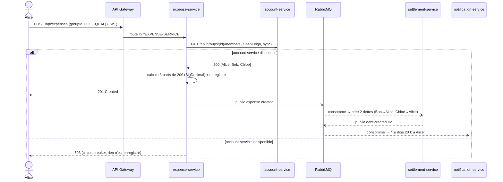 |
| Paiement d'une dette : succès, solde insuffisant, panne du wallet | 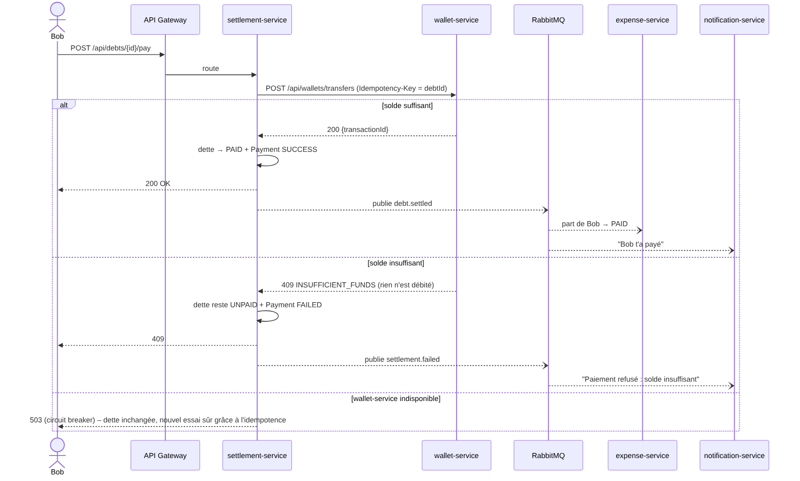 |
| Loyer récurrent avec retry et cas d'échec | 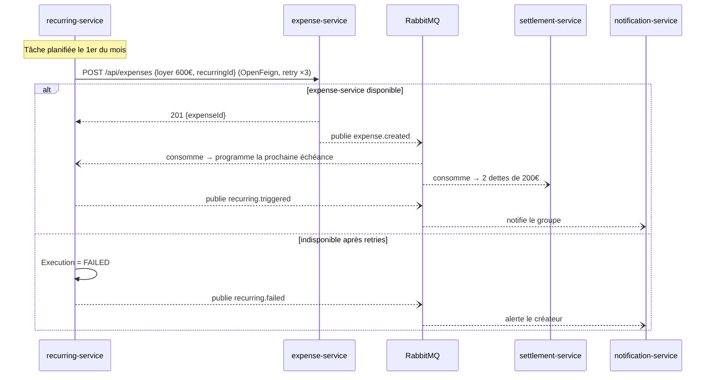 |
| Arrondi vers l'épargne | 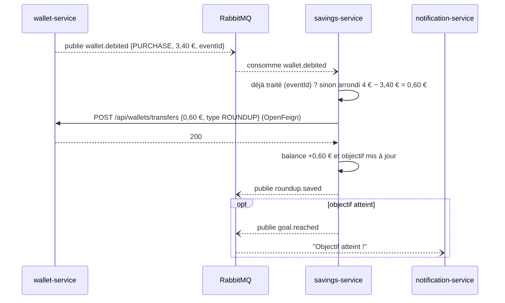 |
| Détection de fraude en temps réel | 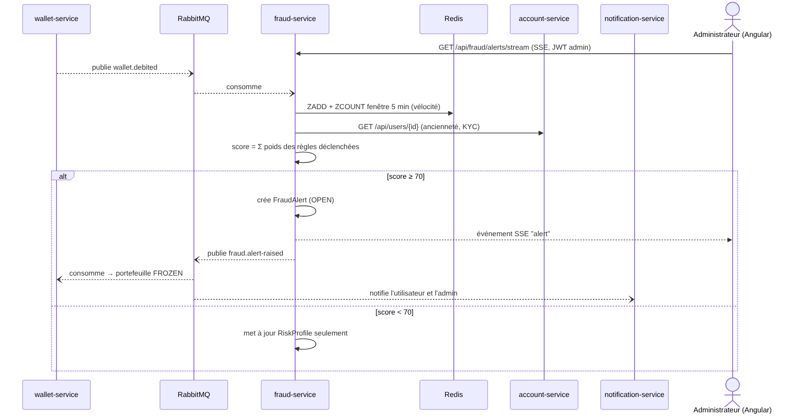 |

### 5.6 Cohérence des données (Saga et idempotence)
Il n'existe pas de transaction distribuée entre services. Le remboursement d'une dette est donc une **saga orchestrée par settlement-service** :
1. appel synchrone `POST /transfers` à wallet avec `Idempotency-Key = debtId` ;
2. si `200` → dette `PAID`, publication de `debt.settled` ;
3. si `409` (solde insuffisant) → dette `UNPAID`, publication de `settlement.failed` (**rien n'a été débité : pas de compensation nécessaire**) ;
4. si timeout / `503` → dette inchangée ; le rejeu avec la même clé renvoie le résultat déjà calculé au lieu de débiter deux fois.

Pour l'arrondi : le transfert `ROUNDUP` porte l'identifiant de l'événement source ; `savings-service` mémorise `sourceEventId` (contrainte d'unicité) et ignore les doublons. Les transferts de type `ROUNDUP` ne redéclenchent pas d'arrondi (filtre sur `type`).

---

## 6. Architecture technique

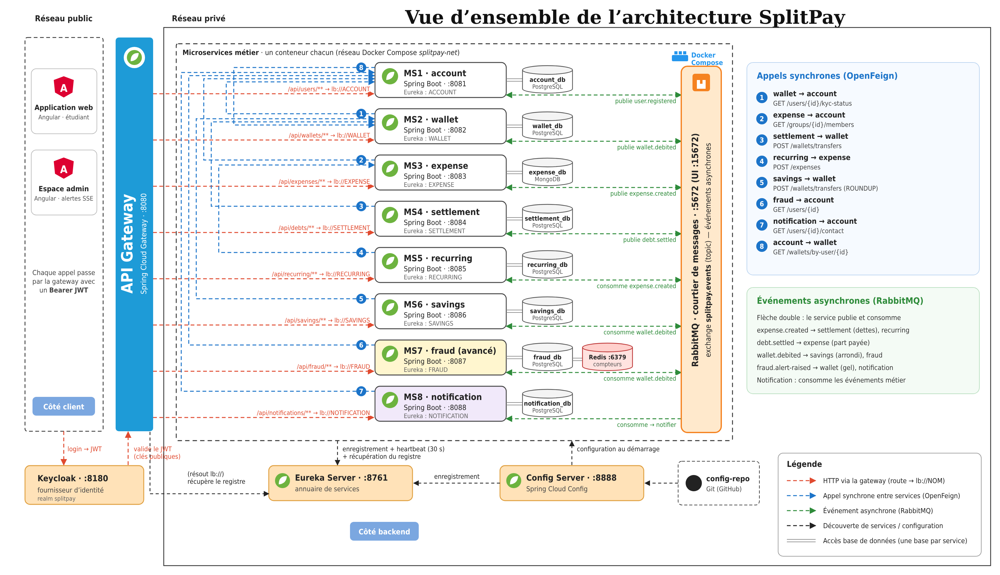

| Composant | Technologie | Rôle |
|---|---|---|
| Frontend | **Angular** (Angular Material, RxJS, `keycloak-angular`, `EventSource` pour le SSE) | SPA étudiant + espace administrateur |
| API Gateway | Spring Cloud Gateway | Point d'entrée unique, routage `lb://`, validation JWT, CORS |
| Découverte | Spring Cloud Netflix **Eureka** | Annuaire de services |
| Configuration | Spring Cloud **Config Server** + dépôt Git `config-repo` | Configuration centralisée |
| Sécurité | **Keycloak** (realm `splitpay`, OAuth2/OIDC, JWT), rôles `STUDENT`, `ADMIN` | Authentification et autorisation |
| Microservices | **Spring Boot 3** (Web, Data JPA / Data MongoDB, Validation, OpenFeign, Resilience4j, Spring AMQP, Scheduling), springdoc-openapi | Logique métier |
| Bases | **PostgreSQL 16** (7 bases), **MongoDB 7** (expense), **Redis 7** (fraud) | Persistance, une base par service |
| Messagerie | **RabbitMQ** | Événements asynchrones |
| Paiement externe | Mock interne (ou Stripe *sandbox*) | Recharge du portefeuille |
| Conteneurisation | **Docker / Docker Compose** | Environnement reproductible, réseau `splitpay-net` |

### Sécurité (exigée pour une application financière)
1. Authentification Keycloak (Authorization Code + PKCE) → JWT ; validation à la Gateway **et** dans chaque service (défense en profondeur).
2. Un étudiant n'accède qu'à **ses** ressources (le `userId` provient du JWT, jamais du corps de la requête) ; rôle `ADMIN` pour KYC, règles et alertes de fraude.
3. Aucun numéro de carte stocké : **token** uniquement, plafond par paiement, clé d'idempotence obligatoire sur les transferts.
4. Services non exposés en dehors du réseau Docker ; seule la Gateway l'est. Secrets hors du dépôt (variables d'environnement).
5. Journalisation d'audit des opérations monétaires (`WalletTransaction` immuable : on ajoute, on ne modifie pas).

### Routage de la Gateway
| Chemin | Cible |
|---|---|
| `/api/users/**`, `/api/groups/**`, `/api/kyc/**` | `lb://ACCOUNT-SERVICE` |
| `/api/wallets/**` | `lb://WALLET-SERVICE` |
| `/api/expenses/**` | `lb://EXPENSE-SERVICE` |
| `/api/debts/**` | `lb://SETTLEMENT-SERVICE` |
| `/api/recurring/**` | `lb://RECURRING-SERVICE` |
| `/api/savings/**` | `lb://SAVINGS-SERVICE` |
| `/api/fraud/**` | `lb://FRAUD-SERVICE` |
| `/api/notifications/**` | `lb://NOTIFICATION-SERVICE` |

Les transferts `/api/wallets/transfers` ne sont **pas** routés par la Gateway vers l'extérieur : ils servent aux appels internes entre services.

### Déploiement
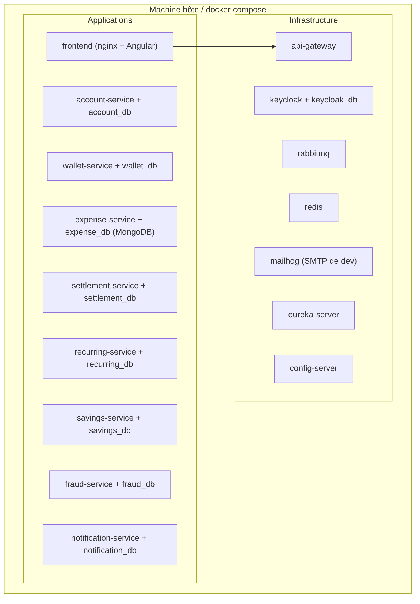

---

## 7. Contrats d'API (principaux endpoints)

Conventions : JSON, pagination `?page=&size=`, erreurs `{timestamp, status, error, code, message, path}`. Codes communs : `400` validation, `401`, `403`, `404`, `409` conflit, `503` dépendance indisponible. OpenAPI : `/swagger-ui.html`.

### MS1 – account-service
| Méthode | URI | Description | Codes |
|---|---|---|---|
| POST | `/api/users` | Créer le profil après la 1ʳᵉ connexion | 201, 400, 409 |
| GET / PUT | `/api/users/me` | Lire / modifier son profil | 200, 400, 404 |
| GET | `/api/users/{id}` | Profil (interne / admin) | 200, 404 |
| GET | `/api/users/{id}/kyc-status` | Statut KYC (interne) | 200, 404 |
| GET | `/api/users/{id}/contact` | E-mail et préférences (interne) | 200, 404 |
| DELETE | `/api/users/me` | Clôturer son compte | 204, 409 (solde non nul) |
| POST | `/api/kyc` | Soumettre une demande KYC | 201, 400, 409 |
| GET | `/api/kyc?status=PENDING` | Lister les demandes (admin) | 200, 403 |
| PATCH | `/api/kyc/{id}` | Valider / rejeter (admin) | 200, 403, 404 |
| POST | `/api/groups` | Créer un groupe | 201, 400 |
| GET | `/api/groups` · `/api/groups/{id}` | Mes groupes · détail | 200, 403, 404 |
| PUT / DELETE | `/api/groups/{id}` | Modifier / supprimer (propriétaire) | 200, 204, 403, 404 |
| GET | `/api/groups/{id}/members` | Membres actifs (interne aussi) | 200, 404 |
| POST | `/api/groups/{id}/members` | Inviter un membre | 201, 403, 404, 409 |
| DELETE | `/api/groups/{id}/members/{userId}` | Retirer / quitter | 204, 403, 404 |

### MS2 – wallet-service
| Méthode | URI | Description | Codes |
|---|---|---|---|
| GET | `/api/wallets/me` | Mon portefeuille et mon solde | 200, 404 |
| GET | `/api/wallets/by-user/{userId}` | Portefeuille d'un utilisateur (interne) | 200, 404 |
| POST | `/api/wallets/me/topups` | Recharger (paiement externe simulé) | 201, 400, 403 (gelé / KYC) |
| POST | `/api/wallets/me/payments` | Payer un commerçant (`PURCHASE`) | 201, 400, 402/409 (solde), 403 (gelé) |
| POST | `/api/wallets/transfers` | Transfert entre portefeuilles (interne, `Idempotency-Key` obligatoire) | 200, 400, 404, 409 (`INSUFFICIENT_FUNDS`), 403 |
| GET | `/api/wallets/me/transactions` | Historique | 200 |
| POST / GET / DELETE | `/api/wallets/me/payment-methods` | Moyens de paiement tokenisés | 201 / 200 / 204 |
| PATCH | `/api/wallets/{id}/status` | Geler / dégeler (admin) | 200, 403, 404 |

### MS3 – expense-service
| Méthode | URI | Description | Codes |
|---|---|---|---|
| POST | `/api/expenses` | Créer une dépense partagée | 201, 400, 403, 503 |
| GET | `/api/expenses?groupId=` | Dépenses d'un groupe | 200, 403 |
| GET | `/api/expenses/{id}` | Détail avec parts | 200, 403, 404 |
| PUT | `/api/expenses/{id}` | Modifier (tant qu'aucune part n'est payée) | 200, 400, 403, 404, 409 |
| DELETE | `/api/expenses/{id}` | Annuler (publie `expense.cancelled`) | 204, 403, 404, 409 |
| GET | `/api/expenses/{id}/shares` | Statut des parts | 200, 404 |

### MS4 – settlement-service
| Méthode | URI | Description | Codes |
|---|---|---|---|
| GET | `/api/debts?role=debtor\|creditor&status=` | Mes dettes / créances | 200 |
| GET | `/api/debts/{id}` | Détail | 200, 403, 404 |
| POST | `/api/debts/{id}/pay` | Rembourser en un clic | 200, 403, 404, 409 (déjà payée / solde), 503 |
| POST | `/api/debts/pay-all` | Payer toutes ses dettes | 207 (multi-statut), 409 |
| PATCH | `/api/debts/{id}` | Annuler / modifier l'échéance (créancier) | 200, 403, 404, 409 |
| GET | `/api/debts/{id}/payments` | Historique des tentatives | 200, 404 |

### MS5 – recurring-service
| Méthode | URI | Description | Codes |
|---|---|---|---|
| POST | `/api/recurring` | Créer une dépense récurrente | 201, 400, 403 |
| GET | `/api/recurring?groupId=` | Lister | 200 |
| GET | `/api/recurring/{id}` | Détail + prochaine échéance | 200, 404 |
| PUT | `/api/recurring/{id}` | Modifier | 200, 400, 403, 404 |
| PATCH | `/api/recurring/{id}/active` | Activer / suspendre | 200, 404 |
| DELETE | `/api/recurring/{id}` | Supprimer | 204, 403, 404 |
| GET | `/api/recurring/{id}/executions` | Historique des exécutions | 200, 404 |

### MS6 – savings-service
| Méthode | URI | Description | Codes |
|---|---|---|---|
| GET | `/api/savings/me` | Compte d'épargne | 200, 404 |
| PUT | `/api/savings/me/settings` | Activer l'arrondi, choisir le pas | 200, 400 |
| POST | `/api/savings/goals` | Créer un objectif | 201, 400 |
| GET | `/api/savings/goals` · `/{id}` | Lister / détail | 200, 404 |
| PUT / DELETE | `/api/savings/goals/{id}` | Modifier / supprimer | 200, 204, 404 |
| GET | `/api/savings/me/roundups` | Historique des arrondis | 200 |

### MS7 – fraud-service (admin)
| Méthode | URI | Description | Codes |
|---|---|---|---|
| GET | `/api/fraud/alerts?status=` | Lister les alertes | 200, 403 |
| GET | `/api/fraud/alerts/{id}` | Détail (règles déclenchées) | 200, 403, 404 |
| PATCH | `/api/fraud/alerts/{id}` | Confirmer / rejeter | 200, 403, 404, 409 |
| GET | `/api/fraud/alerts/stream` | **Flux SSE** des nouvelles alertes | 200 (`text/event-stream`), 403 |
| GET / POST | `/api/fraud/rules` | Lister / créer une règle | 200, 201, 400, 403 |
| PUT / DELETE | `/api/fraud/rules/{id}` | Modifier / supprimer | 200, 204, 403, 404 |
| GET | `/api/fraud/profiles/{userId}` | Profil de risque | 200, 403, 404 |

### MS8 – notification-service (commun)
| Méthode | URI | Description | Codes |
|---|---|---|---|
| GET | `/api/notifications` | Mes notifications | 200 |
| GET | `/api/notifications/unread-count` | Non lues | 200 |
| PATCH | `/api/notifications/{id}/read` · `/read-all` | Marquer comme lue(s) | 204, 404 |
| DELETE | `/api/notifications/{id}` | Supprimer | 204, 404 |

---

## 8. Dépôt Git et outil de gestion de projet

```
SplitPay/
├── Backend/            # un projet Maven par microservice + infrastructure
├── Frontend/           # application Angular
├── Documentation/
│   ├── Presentation/
│   └── Diagrams/
├── docker-compose.infra.yml
└── README.md
```
- **Branches :** `main` (stable) ← `develop` ← `feature/<service>-<sujet>` ; pull request relue par un autre membre ; *Conventional Commits*.
- **Gestion de projet :** GitHub Projects (Kanban), un ticket par fonctionnalité, étiquette par service.
- L'enseignant est ajouté comme collaborateur du dépôt public.

---

## 9. Planning prévisionnel et risques

Dates indicatives, à adapter au calendrier d'examens et à la soutenance finale.

| Phase | Période | Objectifs |
|---|---|---|
| Conception (Validation 1) | jusqu'au 9 nov. 2026 | Dossier, diagrammes, dépôt, projets créés |
| Sprint 1 | 10 – 23 nov. | Infra (Eureka, Config, Gateway, Keycloak, Docker), CRUD de chaque service |
| Sprint 2 | 24 nov. – 7 déc. | Flux principal : dépense → dettes → paiement (REST + événements), idempotence |
| Sprint 3 | 8 – 21 déc. | Récurrence, arrondi, fraud-service (règles + SSE), notifications |
| Sprint 4 | janv. 2027 | Intégration Angular, tests de bout en bout, résilience, démo |

| Risque | Prob. | Impact | Mitigation |
|---|---|---|---|
| **Incohérence des données** (débit sans dette payée, doublon d'événement) | Moyenne | Élevé | Saga orchestrée, `Idempotency-Key`, déduplication par `eventId`, Outbox |
| **Service indisponible** | Moyenne | Moyen | Resilience4j (timeout, retry, circuit breaker, fallback), tests d'arrêt de service |
| **Retard d'un membre / blocage par dépendance** | Moyenne | Élevé | Contrats d'API figés dans ce dossier, mocks WireMock, revue hebdomadaire |
| **Complexité de fraud-service** | Moyenne | Moyen | Pilotage à 2 (M5 + M6), 2 règles d'abord (`VELOCITY`, `AMOUNT_ANOMALY`), les autres ensuite |
| **Trop de conteneurs en local** | Moyenne | Moyen | Profils Compose, démarrage partiel, mock du paiement externe |
| **Sécurité financière** (fuite d'un token, accès à la donnée d'autrui) | Faible | Élevé | `userId` tiré du JWT, aucun numéro de carte, secrets en variables d'environnement |
| **Charge d'examens** | Élevée | Moyen | Sprint 1 léger, tâches courtes |

---

## 10. Répartition des tâches

Voir [`Repartition_Travail.md`](Repartition_Travail.md).

| Membre | Nom | Microservice (CRUD) | Tâche transverse | Module Angular |
|---|---|---|---|---|
| Membre 1 | *à compléter* | MS1 account-service | Keycloak + sécurité Gateway | Connexion, profil, KYC, groupes |
| Membre 2 | *à compléter* | MS2 wallet-service | Docker Compose (bases, RabbitMQ, Redis…) | Portefeuille |
| Membre 3 | *à compléter* | MS3 expense-service | Eureka + Config Server + `config-repo` | Dépenses |
| Membre 4 | *à compléter* | MS4 settlement-service | Squelette Angular (layout, guards, intercepteur JWT) | Dettes, paiement en un clic |
| Membre 5 | *à compléter* | MS5 recurring-service **+ pilote de MS7 fraud-service** | Bibliothèque `splitpay-events` | Récurrences, espace admin (alertes SSE) |
| Membre 6 | *à compléter* | MS6 savings-service **+ co-développeur de MS7** | Documentation, diagrammes, présentation | Épargne, notifications |
| Tous | | MS8 notification-service | Chacun écrit les *listeners* des événements qu'il publie | – |
