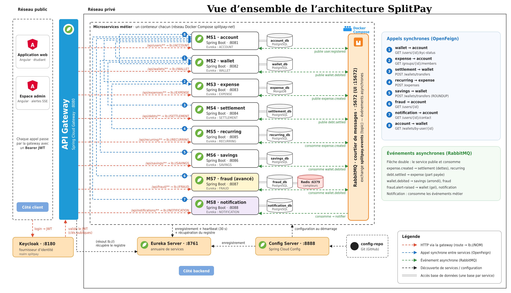

# 💸 SplitPay – Partager les dépenses, se rembourser en un clic, épargner sans y penser

> Projet de microservices – Thème **FinTech** – Module AWD – ESPRIT – 2026-2027

SplitPay est une application pour les étudiants en colocation ou en sortie de groupe : dépenses partagées, remboursement automatique via un **portefeuille intégré**, dépenses récurrentes (loyer, internet), **épargne par arrondi** et **détection de fraude en temps réel**.

## 👥 Équipe
| Membre | Nom | Microservice |
|---|---|---|
| Membre 1 | *à compléter* | account-service |
| Membre 2 | *à compléter* | wallet-service |
| Membre 3 | *à compléter* | expense-service |
| Membre 4 | *à compléter* | settlement-service |
| Membre 5 | *à compléter* | recurring-service + pilote de fraud-service |
| Membre 6 | *à compléter* | savings-service + co-développeur de fraud-service |
| Tous | | notification-service (commun) |

Encadrant : *à compléter* (ajouté comme collaborateur)

## 🧭 Sujet en bref
- **Problème :** avances d'argent, relances et oublis entre colocataires ; dépenses récurrentes recalculées à la main ; peu d'épargne.
- **Acteurs :** Étudiant, Administrateur, Système de paiement externe (simulé), Système.
- **Fonctionnalités :** groupes, dépenses partagées, dettes automatiques, paiement en un clic, récurrences, arrondi et objectifs d'épargne, KYC, alertes de fraude, notifications.

## 🏗️ Architecture



| Composant | Technologie | Port |
|---|---|---|
| Frontend | Angular | 4200 |
| API Gateway | Spring Cloud Gateway | 8080 |
| Eureka / Config | Spring Cloud | 8761 / 8888 |
| Keycloak | OAuth2 / OIDC (JWT) | 8180 |
| RabbitMQ | Événements (`splitpay.events`) | 5672 / 15672 |
| account-service | Spring Boot + PostgreSQL | 8081 |
| wallet-service | Spring Boot + PostgreSQL | 8082 |
| expense-service | Spring Boot + **MongoDB** | 8083 |
| settlement-service | Spring Boot + PostgreSQL | 8084 |
| recurring-service | Spring Boot + PostgreSQL | 8085 |
| savings-service | Spring Boot + PostgreSQL | 8086 |
| **fraud-service** *(avancé)* | Spring Boot + PostgreSQL + **Redis** + SSE | 8087 |
| notification-service *(commun)* | Spring Boot + PostgreSQL | 8088 |

**Communications :** REST / OpenFeign (synchrone) · RabbitMQ (asynchrone) · SSE (alertes en direct vers l'admin). **Une base par microservice, aucune base partagée.** Cohérence : saga orchestrée + clés d'idempotence.

## 📁 Structure du dépôt
```
SplitPay/
├── Backend/                 # un projet Spring Boot par microservice + infrastructure
├── Frontend/                # application Angular
├── Documentation/
│   ├── Dossier_Technique.md    # dossier de conception complet
│   ├── Repartition_Travail.md  # répartition, Git, questions du jury
│   ├── Presentation/           # plan et support de présentation
│   └── Diagrams/               # sources (.mmd/.dot) et images (.png)
├── docker-compose.infra.yml # PostgreSQL ×8, MongoDB, Redis, RabbitMQ, Keycloak, Mailhog
└── README.md
```

## 🚀 Lancement (développement)
**Prérequis :** Java 21, Maven 3.9+, Node 20+, Angular CLI, Docker.
```bash
# 1. Infrastructure
docker compose -f docker-compose.infra.yml up -d

# 2. Ordre de démarrage : config-server → eureka-server → microservices → api-gateway
cd Backend/config-server && mvn spring-boot:run
cd Backend/eureka-server && mvn spring-boot:run
cd Backend/<service>     && mvn spring-boot:run
cd Backend/api-gateway   && mvn spring-boot:run

# 3. Frontend
cd Frontend/splitpay-web && npm install && ng serve      # http://localhost:4200
```
| Interface | URL |
|---|---|
| Eureka | http://localhost:8761 |
| RabbitMQ | http://localhost:15672 (guest / guest) |
| Keycloak | http://localhost:8180 (admin / admin) |
| Mailhog | http://localhost:8025 |
| Swagger d'un service | `http://localhost:<port>/swagger-ui.html` |

> Validation 1 = **conception** : les projets sont créés, la logique métier est développée après validation.

## 📚 Documentation
- [Dossier technique complet](Documentation/Dossier_Technique.md)
- [Répartition du travail et organisation Git](Documentation/Repartition_Travail.md)
- [Plan de la présentation](Documentation/Presentation/Plan_Presentation.md)
- [Diagrammes](Documentation/Diagrams/img/)

## 🔀 Workflow Git
`main` ← `develop` ← `feature/<service>-<sujet>` · pull request relue par un autre membre · *Conventional Commits* · suivi : **GitHub Projects**.

## 🗺️ Planning
| Phase | Période |
|---|---|
| Conception (Validation 1) | jusqu'au 9 nov. 2026 |
| Sprint 1 – infra + CRUD | 10 – 23 nov. |
| Sprint 2 – flux dépense → dette → paiement | 24 nov. – 7 déc. |
| Sprint 3 – récurrence, arrondi, fraude, notifications | 8 – 21 déc. |
| Sprint 4 – intégration Angular, tests, démo | janv. 2027 |
